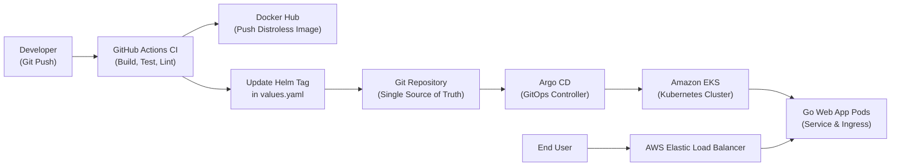
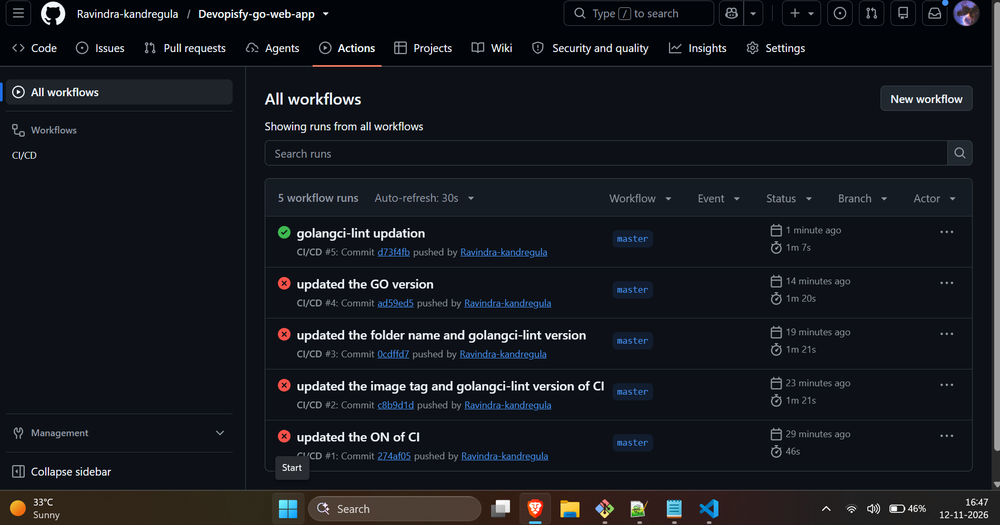
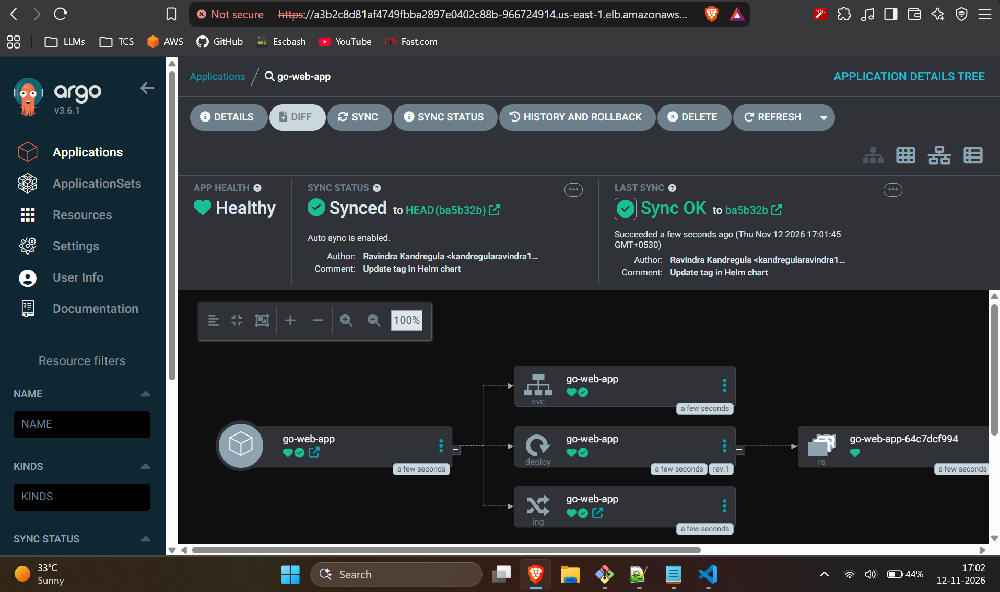
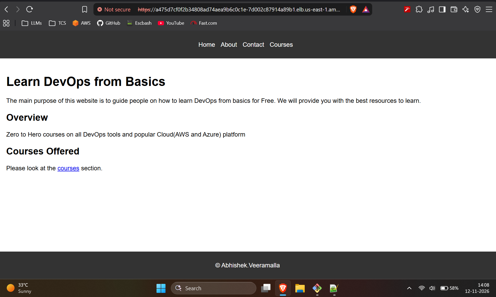
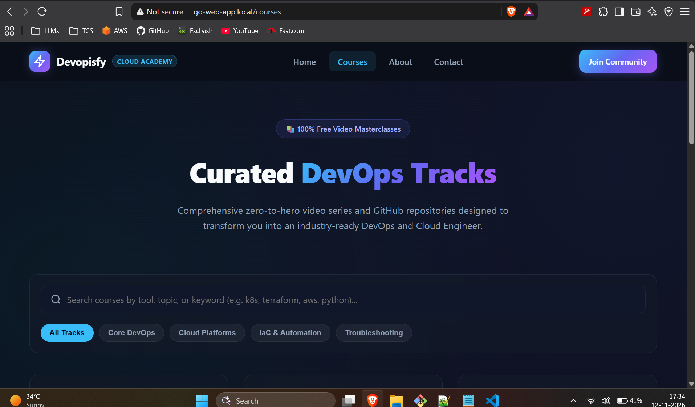

# Devopisfy - Cloud-Native Go Web Application & GitOps Pipeline

[](https://golang.org)
[](https://hub.docker.com)
[](https://kubernetes.io)
[](https://helm.sh)
[](https://argo-cd.readthedocs.io)
[](https://github.com/features/actions)

A production-grade, end-to-end cloud-native web application built with Go, packaged with secure multi-stage distroless containers, and delivered via declarative GitOps using **GitHub Actions**, **Helm**, **Argo CD**, and **Amazon EKS**.

---

## Table of Contents

- [Architecture & GitOps Workflow](#architecture--gitops-workflow)
- [Key Features](#key-features)
- [Tech Stack](#tech-stack)
- [Proof of Execution](#proof-of-execution)
  - [1. GitHub Actions CI Pipeline](#1-github-actions-ci-pipeline)
  - [2. Argo CD GitOps Synchronization](#2-argo-cd-gitops-synchronization)
  - [3. Application Modernization & Delivery](#3-application-modernization--delivery)
- [Repository Structure](#repository-structure)
- [Getting Started](#getting-started)
  - [Prerequisites](#prerequisites)
  - [Local Development](#local-development)
  - [Docker Containerization](#docker-containerization)
- [Deployment via Kubernetes & Helm](#deployment-via-kubernetes--helm)
  - [Using Helm](#using-helm)
  - [Using Raw Kubernetes Manifests](#using-raw-kubernetes-manifests)
- [CI/CD Pipeline Details](#cicd-pipeline-details)
- [Author & Credits](#author--credits)

---

## Architecture & GitOps Workflow

The project implements a declarative GitOps continuous integration and continuous deployment lifecycle:



1. **Commit & Push**: Developer pushes code changes to the `master` branch.
2. **Continuous Integration**: GitHub Actions validates code using `go test` and `golangci-lint`.
3. **Container Build**: Builds a lightweight multi-stage Docker image using Google Distroless and pushes to Docker Hub tagged with `github.run_id`.
4. **GitOps Tag Promotion**: The workflow updates `helm/go-web-app-charts/values.yaml` with the new image tag and commits it back to Git.
5. **Continuous Deployment**: Argo CD detects the updated Helm values in Git and automatically reconciles the deployment on Amazon EKS.
6. **Traffic Routing**: Traffic is served through an NGINX Ingress Controller fronted by an AWS Elastic Load Balancer (ELB).

---

## Key Features

- **Standard Library Go Backend**: Robust, minimal HTTP server serving static assets and dynamic endpoints with route validation.
- **Modern Responsive Frontend**: Dark cosmic theme, responsive navigation, live category filters, search input, and zero external runtime dependencies.
- **Secure Containerization**: Multi-stage Docker build producing a minimalist Google Distroless image (`gcr.io/distroless/base`), reducing image attack surface and CVE footprint.
- **Automated Quality Gates**: CI pipeline enforcing automated unit testing and strict static analysis via `golangci-lint`.
- **Declarative Continuous Delivery**: Zero-downtime, self-healing deployments orchestrated by Argo CD with automated drift detection.
- **Enterprise Kubernetes Packaging**: Parameterized Helm charts for flexible environment configuration, scaling, and rolling updates.

---

## Tech Stack

| Domain | Technologies Used |
| :--- | :--- |
| **Backend** | Golang (Go 1.21.10), Standard `net/http`, `httptest` |
| **Frontend** | HTML5, Modern Responsive CSS3, Vanilla JS, SVG Vector Icons |
| **Containerization** | Docker, Multi-Stage Builds, Google Container Tools (Distroless) |
| **CI Engine** | GitHub Actions (`actions/checkout`, `actions/setup-go`, `docker/build-push-action`, `golangci-lint-action`) |
| **CD & GitOps** | Argo CD (v3.6.1) with Auto-Sync & Self-Healing |
| **Orchestration** | Amazon EKS (Kubernetes v1.28+), Helm v3 |
| **Networking & Ingress** | NGINX Ingress Controller, AWS Elastic Load Balancer (ELB) |

---

## Proof of Execution

All live execution proofs and dashboard captures are stored in the [`screenshots/`](screenshots/) directory.

### 1. GitHub Actions CI Pipeline

The CI workflow automatically executes unit tests, runs `golangci-lint` static code analysis, builds and pushes the container image to Docker Hub, and updates the Helm values with the new container tag.



* **Status**: Successful run (`#5: golangci-lint updation`) completed in **1m 7s**.
* **Key stages executed**: `build` -> `code-quality` -> `push` -> `update-newtag-in-helm-chart`.

---

### 2. Argo CD GitOps Synchronization

Argo CD continuously monitors the repository Helm charts and reconciles desired state on the Amazon EKS cluster.



* **Endpoint**: Hosted and accessible via AWS ELB.
* **App Health**: `Healthy` | **Sync Status**: `Synced to HEAD (ba5b32b)`.
* **Topology**: Managed Deployment (`deploy: go-web-app`), Service (`svc: go-web-app`), Ingress (`ing: go-web-app`), and ReplicaSet (`rs: go-web-app-64c7dcf994`).

---

### 3. Application Modernization & Delivery

The application was redesigned from a legacy layout into an interactive, modern platform and verified live through Kubernetes Ingress routing.

| Legacy Application (Before) | Modernized Platform (After) |
| :---: | :---: |
|  |  |
| *Original unstyled layout* | *Live on EKS via Ingress (`go-web-app.local`)* |

---

## Repository Structure

```text
├── .github/
│   └── workflows/
│       └── cicd.yaml              # Complete CI/CD GitHub Actions workflow
├── eks/                           # Amazon EKS setup and prerequisite documentation
│   ├── 01-prereq.md
│   └── 02-install-eks-fargate.md
├── gitops/                        # Argo CD installation & setup guides
│   └── argocd/
│       └── 01-install.md
├── helm/                          # Helm charts for Kubernetes deployment
│   └── go-web-app-charts/
│       ├── Chart.yaml
│       ├── values.yaml            # Environment values & image tags
│       └── templates/
│           ├── deployment.yaml
│           ├── service.yaml
│           └── ingress.yaml
├── ingress-controller/            # Ingress controller configuration guides
│   └── nginx/
│       └── 01-installation.md
├── k8s/                           # Raw Kubernetes manifests (alternative to Helm)
│   └── manifests/
│       ├── deployment.yaml
│       ├── service.yaml
│       └── ingress.yaml
├── screenshots/                   # Execution proofs & verification captures
│   ├── Devopsify_CI_pipleine.png
│   ├── Devopsify_ArgoCD.png
│   ├── Devopsify_intial.png
│   └── Devopsify_updated.png
├── static/                        # Web application static files & templates
│   ├── home.html
│   ├── courses.html
│   ├── about.html
│   └── contact.html
├── Dockerfile                     # Multi-stage distroless build specification
├── go.mod                         # Go module declaration
├── main.go                        # Application entry point & HTTP router
├── main_test.go                   # HTTP handler unit tests
└── README.md                      # Project documentation
```

---

## Getting Started

### Prerequisites

- [Go](https://go.dev/dl/) (v1.21 or later)
- [Docker](https://docs.docker.com/get-docker/) (v24 or later)
- [kubectl](https://kubernetes.io/docs/tasks/tools/) & [Helm](https://helm.sh/docs/intro/install/) (v3)

### Local Development

1. **Clone the repository:**
   ```bash
   git clone https://github.com/Ravindra-kandregula/Devopisfy-go-web-app.git
   cd Devopisfy-go-web-app
   ```

2. **Run tests:**
   ```bash
   go test -v ./...
   ```

3. **Start the local server:**
   ```bash
   go run main.go
   ```
   Open `http://localhost:8080/` in your browser.

### Docker Containerization

Build and run the multi-stage distroless container locally:

```bash
# Build the Docker image
docker build -t go-web-app:latest .

# Run the container
docker run -d -p 8080:8080 --name go-web-app go-web-app:latest

# Verify logs
docker logs -f go-web-app
```

---

## Deployment via Kubernetes & Helm

### Using Helm

Deploy to your Kubernetes cluster (e.g., AWS EKS):

```bash
# Install the Helm chart
helm install go-web-app ./helm/go-web-app-charts

# Verify deployment status
kubectl get pods,svc,ingress -l app=go-web-app
```

### Using Raw Kubernetes Manifests

```bash
kubectl apply -f k8s/manifests/
```

---

## CI/CD Pipeline Details

The GitHub Actions workflow defined in [`.github/workflows/cicd.yaml`](.github/workflows/cicd.yaml) triggers on every push to `master`:

1. **`build`**: Sets up Go 1.21.10, checks out code, compiles the Go binary, and runs unit tests.
2. **`code-quality`**: Runs `golangci-lint` (v1.59.1) to enforce Go coding standards.
3. **`push`**: Uses Docker Buildx to build and push the container image to Docker Hub tagged with `${{ github.run_id }}`.
4. **`update-newtag-in-helm-chart`**: Updates the `tag` value inside `helm/go-web-app-charts/values.yaml` and commits the change back to the repository, triggering Argo CD synchronization.

---

## Author & Credits

- **Author / Maintainer**: [Ravindra Kandregula](https://github.com/Ravindra-kandregula)
- **Course Inspiration**: [Abhishek Veeramalla](https://github.com/iam-veeramalla) - DevOps Zero to Hero Curriculum
- **License**: MIT License
